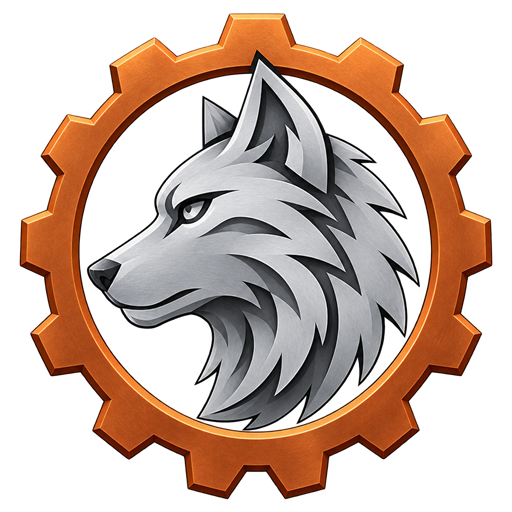

# SCMW — Lone Wolf

An unofficial desktop tool for making **SCUM** mods on Windows: browse the game's items, change
their values, build a mod `.pak`, install it, and manage your mods.

## Unofficial

SCMW — Lone Wolf is an **unofficial, fan-made tool**. It is **not affiliated with, endorsed by, or
supported by Gamepires** (the makers of SCUM) or by Valve/Steam. "SCUM" and related names belong to
their owners.

You use it **at your own risk**. Mods are your own responsibility, and you should only use them
where the game or server allows. SCMW — Lone Wolf does not include any of SCUM's own assets, and it does
not ship the game's unlock key.

## Requirements

- Windows 64-bit
- SCUM, installed through Steam
- The game's **unlock key** — see [The unlock key](#the-unlock-key) below.

## The unlock key

SCUM's game files are encrypted. To read (and mod) them, tools like SCMW — Lone Wolf need SCUM's **unlock
key** — a shared decryption key, the same for every player and the same one other SCUM tools use.

- **What it is:** a decryption key for SCUM's game files.
- **What it isn't:** a Steam key or product key. It does **not** buy, activate, or install SCUM, and
  it has nothing to do with your Steam account.

SCMW — Lone Wolf **does not bundle** the key. To find it: open the app, go to **Settings → Unlock key**, and
press **Where do I get this?** — it links to a public key list (no download or sign-up). Paste the
key in once and press **Test**. It's kept on your PC only.

## Download and run

1. Open the [**Releases**](https://github.com/scummoddingworkshop-byte/SCMW-Lone-Wolf/releases) page
   and download the latest **`SCMW-Lone-Wolf-v…-win-x64.zip`**.
2. **Unzip** it into a folder you'll keep (for example `C:\Apps\SCMW-Lone-Wolf`) — keep the whole
   folder together.
3. Run **`SCMW-Lone-Wolf.exe`**.
4. First run — open **Settings**: press **Detect** to find your SCUM folder, paste your
   **unlock key**, then press **Test**.

There is **no installer and no separate .NET install** — it is self-contained and portable (delete
the folder to remove it). Windows may warn the first time you run it — see
[Windows may warn](#windows-may-warn).

## Sandbox and servers

SCMW — Lone Wolf is made for playing SCUM in **Sandbox (local) mode**, where your mods load straight
away. On a **server**, mods only work if the **server admin allows them** — you can't add a mod to
someone else's server. Server admins can still use this tool to **create** mods, then deploy them to
the server manually and share them with their players.

## Getting started

Open the app and use the **Help** screen (bottom of the sidebar) for a plain-language walkthrough.
In short: set your SCUM folder and unlock key in **Settings**, create a **project**, edit your
items, then **Build** and **Install into SCUM**.

## Windows may warn

SCMW — Lone Wolf is **unsigned**, so on first launch Windows **SmartScreen** may show *"Windows
protected your PC"*. This is expected for a small free tool — click **More info → Run anyway**.

Some antivirus tools also flag the **bundled packers** — the small open-source helpers that unpack
and repack SCUM's files (such as `repak`). They are legitimate, listed in
**`THIRD-PARTY-NOTICES.md`**, and ship with the app. If your antivirus quarantines one, allow it for
the app folder.

## Updating

Updating is **safe**. Your work lives **outside** the app folder, so replacing it doesn't touch anything:

- **Projects, built mods, backups** → `Documents\SCMW`
- **Settings and your unlock key** → `%APPDATA%\SCMW`

To update: download the new version and **replace the app folder**. Nothing else needs deleting.

## Uninstalling

Lone Wolf is **portable** — there's **no installer, no registry entries, and no services**. To remove it:

1. **(Optional)** Take your mods out of the game first — **Build → Remove from SCUM**, or the **Mods**
   screen — so SCUM is left clean.
2. **Close the app.**
3. **Delete the app folder** (wherever you unzipped it).

That's the uninstall. Your **projects and settings are left untouched**, so a reinstall picks up where
you left off. To remove it *completely*, also delete these two folders:

- **Your work (the workspace).** The easy way to find it: open the app, then **Settings → Workspace →
  Open folder**. (It's usually in your **Documents** folder.) ⚠️ **Deleting it removes your projects and
  backups for good.**
- **Your settings (including the unlock key).** To find it, **paste this into the address bar of File
  Explorer** and press Enter: `%APPDATA%\SCMW`

## Licence

SCMW — Lone Wolf is free software under the **GNU General Public License, version 3 (GPL-3.0)** —
Copyright (C) 2026 **Franxxu**. See the **`LICENSE`** file.

In plain terms: you may use, study, share and modify it, and forks are welcome — but if you
distribute a modified version, it must stay open-source under the same licence, and you must keep
the copyright notice.

It bundles third-party open-source components — see **`THIRD-PARTY-NOTICES.md`** and the
**`licenses/`** folder.

## Support

SCMW — Lone Wolf is free, and always will be. If you'd like to say thanks, you can leave a tip on
**Ko-fi**: <https://ko-fi.com/scmwlonewolf>. There's also a **Support on Ko-fi** button in the app
(**Settings → About**). Tips are entirely optional — the app is complete without them.

## Name

**"SCMW — Lone Wolf"** (and "SCMW"), with any logo or branding, are the project's identity and are
**not licensed** with the code — a formal term under section 7(e) of the GPL (see the **`NOTICE`**
file). Forks are welcome, but please give them their **own name** and don't imply this project
endorses them.

